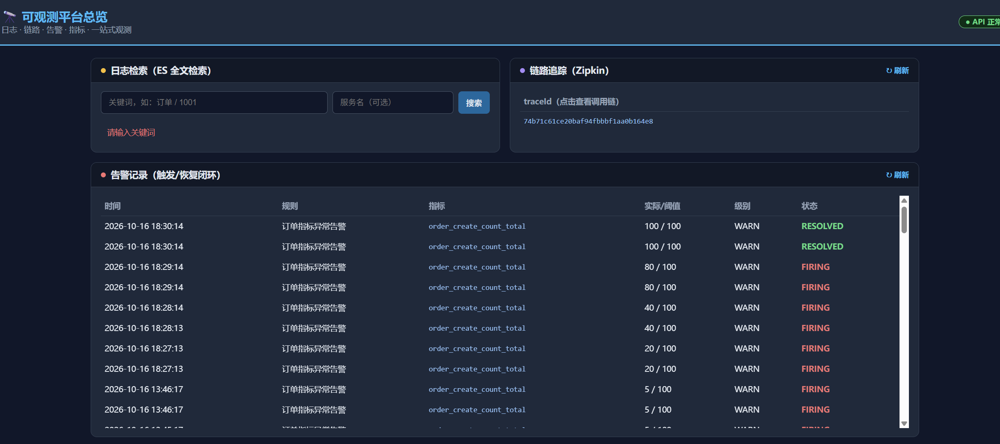
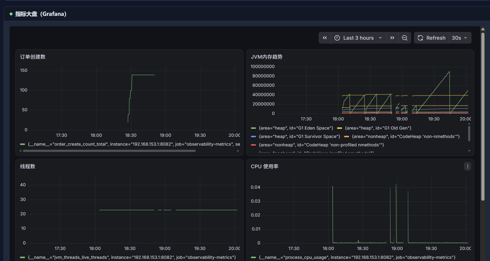

# Observability Platform · 轻量可观测平台

> 面向多微服务场景的轻量级可观测性平台：**日志采集、指标监控、分布式链路追踪、告警管理** 四大能力一站式落地。
> 技术栈：Spring Boot 3 · Java 17 · Maven 多模块 · RabbitMQ · Prometheus · Elasticsearch · Zipkin · MySQL · Grafana · 钉钉机器人

---

## 项目简介

在微服务架构下，一次用户请求会穿越多个服务。当系统出现故障时，如何快速回答三个问题——

1. **发生了什么？**（日志）
2. **系统现在健康吗？**（指标）
3. **这次请求卡在哪个环节？**（链路）

本项目从零实现了一套轻量可观测平台，将上述能力以 **5 个独立服务** 的形式提供，并对接业界成熟的存储/展示中间件，形成"**发现问题 → 定位环节 → 定位原因 → 验证恢复**"的完整排查闭环。

---

## 系统架构

```
┌─────────────────────────────────────────────────────────────────┐
│                          微服务（业务侧）                         │
│        上报日志  │  上报指标  │  上报调用Span                        │
└────────┬─────────┴─────┬─────┴────────┬──────────────────────────┘
         │               │              │
         ▼               ▼              ▼
┌──────────────┐ ┌──────────────┐ ┌──────────────┐
│ 日志采集服务 │ │ 指标监控服务 │ │ 链路追踪服务 │
│  :8081       │ │  :8082       │ │  :8083       │
│ collector    │ │ metrics      │ │ tracing      │
└──────┬───────┘ └──────┬───────┘ └──────┬───────┘
       │                │                │
       ▼                │                ▼
┌──────────────┐        │          ┌──────────────┐
│  RabbitMQ    │        │          │   Zipkin     │
│ log.queue    │        │          │  链路展示    │
│ 削峰+持久化  │        │          └──────────────┘
└──────┬───────┘        │
       ▼                ▼
┌──────────────┐ ┌──────────────┐
│ 日志消费服务 │ │ Prometheus   │
│  :8086       │ │   时序存储   │
│ consumer     │ └──────┬───────┘
│ 批量写ES     │        │
└──────┬───────┘        ▼
       ▼          ┌──────────────────┐
┌──────────────┐  │   告警管理服务    │ :8084
│Elasticsearch │  │      alert       │
│  全文检索    │  └───────┬──────────┘
└──────────────┘          │
                  ┌───────┴──────────┐
                  ▼                  ▼
            ┌──────────┐      ┌──────────┐
            │  MySQL   │      │ 钉钉机器人 │
            │ 告警记录 │      │ 告警通知  │
            └──────────┘      └──────────┘

        Prometheus ──► Grafana（:3000 可视化大盘，指标一屏展示）
```

---

## 模块说明

| 模块 | 端口 | 核心能力 | 存储/对接 |
|---|---|---|---|
| **observability-collector** | 8081 | 日志上报、参数校验、分级压缩（摘要化）、批量发布到 RabbitMQ（只收不存，秒回） | RabbitMQ |
| **observability-consumer** | 8086 | 批量消费日志（攒批 200 条/1s）、按天索引批量写 ES（ILM 自动淘汰）、手动 ACK、失败进死信队列 | RabbitMQ + Elasticsearch |
| **observability-metrics** | 8082 | 指标上报（counter/gauge/timer）、Micrometer 注册、Prometheus 暴露 | Prometheus |
| **observability-tracing** | 8083 | Span 上报、Trace 查询、跨服务调用链模拟 | Zipkin |
| **observability-alert** | 8084 | 告警规则 CRUD、定时检测引擎、防抖、告警落库、钉钉通知 | MySQL + 钉钉 |
| **observability-web** | 8085 | 统一展示前端：聚合日志/链路/告警数据 + 嵌入 Grafana 大盘 | 各模块 + Grafana |
| **observability-common** | - | 统一返回体 ApiResponse、共享 DTO LogEntry | - |

### 技术要点

- **日志削峰**：collector 只收不存，日志发布到 RabbitMQ（队列 durable + 消息持久化 + publisher confirm），ES 宕机不丢、接口秒回
- **批量发布**：应用层攒批（攒够 100 条或 10ms 发一批），把 N 次 AMQP 网络往返 + N 次落盘 fsync 合并为 1 次，解决单条发布+持久化的吞吐瓶颈；批量消息仍保留 publisher confirm（整批一条 correlation）
- **分级压缩**：ERROR/WARN 异常日志全量保真（定位错误依据）；INFO/DEBUG 正常日志摘要化——正则抽取 `key=value` 键值对进 tags（结构化保留关键业务信息，可精确检索），message 本体只留短摘要，显著减小 MQ 与 ES 存储压力
- **批量消费**：consumer 批量监听容器（攒 200 条或 1 秒投递），按天索引批量写 ES（一次 bulk，严格校验响应，失败即重试/死信），写成功才批量 ACK，失败重试一次后 NACK 进死信队列兜底
- **索引生命周期（ILM）**：日志按天滚动索引（`logs-yyyy.MM.dd`），启动时自动创建 ILM 策略（hot 保留 7 天 → 到期 delete）+ 索引模板（`logs-*` 自动挂 ILM、显式 mapping、加入 `logs` 别名），检索端经别名聚合所有日期索引，存储成本自动受控、免手工清理
- **指标**：Micrometer `MeterRegistry` 统一注册 Counter/Gauge/Timer，`/actuator/prometheus` 端点暴露，Prometheus 每 15s 拉取
- **链路**：Span 遵循 Zipkin v2 标准（traceId/spanId 十六进制、parentId 层级），异步转发 Zipkin 展示树形调用链
- **告警**：`@Scheduled` 定时检测引擎（默认 60s/轮），连续命中计数实现防抖，触发后落库 + 钉钉 webhook 通知；指标恢复正常自动生成 RESOLVED 记录并推送"已恢复"通知，形成告警生命周期闭环
- **展示**：`observability-web` 聚合层，前端统一入口 8085，代理转发各模块接口（无跨域），嵌入 Grafana 大盘，日志/链路/告警一页总览
- **校验**：Spring Validation（`@NotBlank`/`@Pattern`/`@Size`），统一 `GlobalExceptionHandler` 返回 400/500
- **安全**：敏感配置（数据库密码、webhook、MQ 密码）通过 `.gitignore` 排除，不进入版本库

---

## 快速启动

### 1. 中间件（Docker）

| 中间件 | 容器 | 端口 | 说明 |
|---|---|---|---|
| Elasticsearch | elasticsearch | 9200 | 单节点，`xpack.security.enabled=false` |
| RabbitMQ | rabbitmq | 5672 / 15672 | `log.queue` 削峰缓冲；15672 为管理界面 |
| Prometheus | prometheus | 9090 | 需配置抓取 `prometheus.yml` → 指标服务地址 |
| Zipkin | zipkin | 9411 | 内存存储，开发演示够用 |
| MySQL | mysql8 | 3306 | 建库 `observability_alert`，用户/密码见本地配置 |
| Grafana | grafana | 3000 | 可视化大盘，数据源接 Prometheus |

### 2. 启动服务

```bash
# 先 install 公共模块
mvn -pl observability-common install

# 分别启动服务（IDEA 直接 Run 启动类亦可）
mvn -pl observability-collector spring-boot:run   # 8081 日志采集（只收消息）
mvn -pl observability-consumer spring-boot:run    # 8086 日志消费（批量写 ES）
mvn -pl observability-metrics spring-boot:run     # 8082
mvn -pl observability-tracing spring-boot:run     # 8083
mvn -pl observability-alert spring-boot:run       # 8084
mvn -pl observability-web spring-boot:run         # 8085 统一展示前端
```

> 各服务的数据库/中间件连接配置位于各模块 `src/main/resources/application.yml`（本地私有，不入库），按实际环境填写。
>
> 统一展示前端入口：`http://localhost:8085`（日志检索 / 链路树形 / 告警记录 / Grafana 大盘一页总览）。

---

## API 一览

### 日志采集（8081）
| 方法 | 路径 | 说明 |
|---|---|---|
| POST | `/api/logs` | 上报单条日志 |
| POST | `/api/logs/batch` | 批量上报日志 |
| GET | `/api/logs/search?keyword=xxx&serviceName=xxx` | 全文检索日志（keyword 必填，serviceName 可选过滤） |

### 指标监控（8082）
| 方法 | 路径 | 说明 |
|---|---|---|
| POST | `/api/metrics` | 上报业务指标（counter/gauge/timer） |
| GET | `/api/metrics` | 查询指标台账 |
| GET | `/actuator/prometheus` | Prometheus 抓取端点 |

### 链路追踪（8083）
| 方法 | 路径 | 说明 |
|---|---|---|
| POST | `/api/tracing/spans` | 上报一段调用 Span |
| GET | `/api/tracing/traces/{traceId}` | 查询整条调用链 |
| GET | `/api/tracing/traces` | 列出所有 traceId |
| POST | `/api/tracing/simulate` | 模拟 gateway→order→inventory 三段调用链 |

### 告警管理（8084）
| 方法 | 路径 | 说明 |
|---|---|---|
| POST | `/api/alerts/rules` | 新增告警规则 |
| GET | `/api/alerts/rules` | 规则列表 |
| PUT | `/api/alerts/rules/{id}/enable` | 启用/停用规则 |
| DELETE | `/api/alerts/rules/{id}` | 删除规则 |
| GET | `/api/alerts/records` | 告警记录列表 |

### 统一展示前端（8085）
| 方法 | 路径 | 说明 |
|---|---|---|
| GET | `/` | 总览页（日志/链路/告警/Grafana 一页展示） |
| GET | `/api/logs/search?keyword=&serviceName=` | 代理 8081 日志检索 |
| GET | `/api/tracing/traces` / `/traces/{traceId}` | 代理 8083 链路查询 |
| GET | `/api/alerts/rules` / `/records` | 代理 8084 告警查询 |

---

## 微服务接入指南

本平台面向的是**业务微服务主动上报**。接入一次后全自动，无需人工干预（生产环境不使用 Postman 手动上报）。

### 1. 日志接入（自动转发）

业务微服务引入 logstash 日志编码器，配置 HTTP Appender 将日志自动转发到采集服务：

```xml
<dependency>
  <groupId>net.logstash.logback</groupId>
  <artifactId>logstash-logback-encoder</artifactId>
  <version>7.4</version>
</dependency>
```

```xml
<!-- logback-spring.xml：所有日志自动 POST 到采集服务 -->
<appender name="OBS" class="net.logstash.logback.appender.HttpAppender">
  <url>http://<collector-host>:8081/api/logs</url>
  <encoder class="net.logstash.logback.encoder.LogstashEncoder"/>
</appender>
```

业务代码正常打日志（`log.info("订单创建成功")`），日志即自动进入平台 ES，可全文检索。

### 2. 指标接入（自动采集）

业务微服务引入 Actuator + Micrometer Prometheus 注册器：

```xml
<dependency>
  <groupId>org.springframework.boot</groupId>
  <artifactId>spring-boot-starter-actuator</artifactId>
</dependency>
<dependency>
  <groupId>io.micrometer</groupId>
  <artifactId>micrometer-registry-prometheus</artifactId>
</dependency>
```

- **系统指标**（JVM 内存/线程/CPU、HTTP 请求延迟）：框架自动采集，暴露 `/actuator/prometheus`
- **业务指标**（订单数等）：注入 `MeterRegistry` 注册 Counter/Gauge/Timer，一行代码累加即上报
- Prometheus 配置抓取该服务的 `/actuator/prometheus` 地址即可

### 3. 链路接入（自动埋点传播）

业务微服务引入 Micrometer Tracing + Zipkin 桥接：

```xml
<dependency>
  <groupId>io.micrometer</groupId>
  <artifactId>micrometer-tracing-bridge-brave</artifactId>
</dependency>
<dependency>
  <groupId>io.zipkin.reporter2</groupId>
  <artifactId>zipkin-reporter-brave</artifactId>
</dependency>
```

```yaml
management:
  tracing:
    sampling:
      probability: 1.0    # 全量采样
  zipkin:
    tracing:
      endpoint: http://<tracing-host>:8083/api/tracing/spans   # 上报平台链路服务
```

接入后**请求自动生成 traceId 并跨服务传播**（HTTP header），每个服务耗时自动上报，Zipkin 形成树形调用链；同一请求的日志/指标/Spans 均携带同一 traceId，可跨模块串联排查。

---

## 验证结果

**日志接口压测**（JMeter，100 并发，60s，线程池口径统一为 2/8/1000，三组单变量对比）：

| 链路 | 线程池 | 吞吐 | 错误率 | P99 |
|---|---|---|---|---|
| 直写 ES（原始链路） | 2/8/1000 | 11,519 req/s | 0% | 14ms |
| 单条发布 + 持久化（首版 MQ） | 2/8/1000 | 2,515 req/s | 0% | 206ms |
| **批量发布 + 持久化（当前）** | **2/8/1000** | **21,670 req/s** | **0%** | **19ms** |

> 结论：吞吐下降的元凶是"单条发布 + 每条落盘 fsync"；批量发布把网络往返与 fsync 次数合并，吞吐不降反升（接口只发 MQ 不再写 ES），且持久化不丢的保障不变。

- **MQ 链路验证**（Python 50 并发，5000 条，collector 只收消息链路）：**5000/5000 全部成功**，0 失败，0 丢失；日志全部经 MQ 批量消费落库 ES（客户端为压测瓶颈，QPS 以 JMeter 口径为准）
- **分级压缩验证**：INFO 日志 message 摘要化（≤150 字符 + `[summary]` 标记），`key=value` 键值对自动抽取进 tags 可精确检索；ERROR/WARN 日志全量保留（含完整堆栈）
- **ILM 滚动索引验证**：日志写入按天索引 `logs-2026.10.17`，模板自动挂 ILM 策略 + `logs` 别名，检索经别名聚合命中；ILM 策略 hot 7d → delete 生效（过期索引自动删除）
- **链路追踪**：Zipkin UI 正确展示 3 段跨服务树形调用链（gateway → order-service → inventory-service）
- **告警闭环**：规则配置 → Prometheus 指标比对 → 触发落库 → 钉钉群实时收到告警消息
- **可视化大盘**：Grafana 接入 Prometheus，一屏展示业务指标（订单计数）、系统指标（JVM 内存/线程/CPU）、性能指标（HTTP 平均延迟）
- **统一展示前端**：8085 总览页聚合日志检索、链路树形、告警记录（触发/恢复）、Grafana 大盘，匿名嵌入免登录

### 全链路联调验证

用一个统一 traceId 贯穿日志、指标、链路三大模块，验证平台闭环：

| 步骤 | 操作 | 验证结果 |
|---|---|---|
| ① 日志 | 上报订单日志（携带 traceId） | 经 RabbitMQ 削峰 → consumer 批量写 ES → 按 traceId 全文检索命中 |
| ② 指标 | 上报订单创建计数 +5×5 | Prometheus 指标递增，Grafana 曲线可见 |
| ③ 链路 | 上报 gateway→order→inventory 三段 Span | 树形展示父子关系正确（链路根 → 子节点） |
| ④ 检索 | 用同一 traceId 搜索日志 | `multi_match` 覆盖 message+traceId，命中关联日志 |
| ⑤ 告警 | 指标触发规则 | FIRING 落库 + 钉钉实时通知；指标恢复后自动 RESOLVED |

**联调发现并修复的问题**：
1. 日志检索原本只覆盖 `message` 字段，按 traceId 搜索返回空 → 查询改为 `multi_match`（message + traceId 双字段）。
2. MQ 消息 JSON 携带类名类型头，collector 与 consumer 各自持有 DTO 导致反序列化失败 → `LogEntry` 提升至 `observability-common` 共享，两侧类型头一致。
3. 批量发布后消息体为 JSON 数组，Spring AMQP 类型头对 List 泛型反序列化不可靠 → consumer 改用 `ObjectMapper + TypeReference<List<LogEntry>>` 直接解析 body，绕开类型头。
4. 分级压缩后关键信息迁移至 tags → 检索查询由 `message + traceId` 扩展为 `message + traceId + tags.*`，保证按业务键值（如 orderId）可搜。
5. ILM 滚动索引落地时，collector 的 Spring Data repo 自动创建空索引 `logs`，与模板要求的 `logs` 别名同名冲突导致写入 400 → repo 关闭自动建索引（`createIndex=false`），索引/别名统一由 consumer 模板管理。
6. 早期联调遗留：consumer 解析失败的消息批量进入死信队列 log.dlq（约 15 万条历史压测数据）→ 已清理，后续写入校验 bulk 响应，失败即重试/死信，杜绝"ACK 了但数据没落库"。

---

## 界面展示

### 统一展示前端（8085 总览页）

日志全文检索、链路树形追踪、告警记录（触发/恢复状态一目了然）一页总览。



### Grafana 指标大盘

业务指标（订单创建数）、系统指标（JVM 内存/线程数/CPU 使用率）、性能指标一屏可视化。



---

## Git 提交规范

- 一次提交 = 一个完整功能（`feat:`）或一次修复（`fix:`）
- 敏感配置（密码/webhook/内网地址）不入库，通过 `.gitignore` 排除
- 每次修改同步更新本 README

---

## Roadmap

- [x] 日志采集 + ES 存储
- [x] 日志全文检索查询接口（`GET /api/logs/search?keyword=`）
- [x] 指标监控 + Prometheus
- [x] 链路追踪 + Zipkin
- [x] 告警管理 + 钉钉通知
- [x] 告警恢复（RESOLVED）机制，指标恢复正常自动通知
- [x] Grafana 可视化大盘（业务/系统/性能指标一屏展示）
- [x] 统一展示前端（8085 聚合页，日志/链路/告警/指标一页总览）
- [x] 日志链路接入 RabbitMQ 削峰（collector 只收不存 + consumer 批量写 ES + 死信队列兜底）
- [x] 批量发布优化（应用层攒批，吞吐 2,515 → 21,670 req/s，持久化保障不变）
- [x] 日志分级压缩（异常日志全量、正常日志摘要化 + 键值对抽取，减小 ES 存储压力）
- [x] ES 索引生命周期（ILM：按天滚动索引 + hot 7 天自动删除 + 别名聚合检索）
- [ ] 告警静默（silence）与通知升级策略
